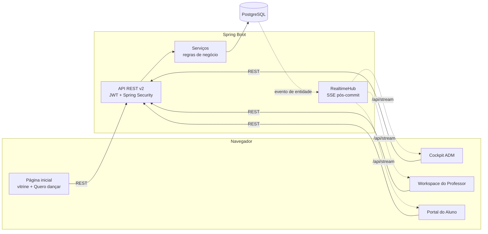

<div align="center">


<br>

**Plataforma completa de gestão para estúdios e companhias de dança.**<br>
Três portais, um único banco de dados e tudo sincronizado em tempo real.

<br>


[Sobre](#-sobre-o-projeto) ·
[Os três palcos](#-os-três-palcos) ·
[Destaques](#-destaques) ·
[Como executar](#-como-executar) ·
[Arquitetura](#-arquitetura) ·
[Criadores](#-criadores)

<br>

📘 **[Manual completo do sistema (PDF)](docs/manual-vibedance.pdf)** · [versão em página web](docs/manual.html)

</div>

---

## 🩰 Sobre o projeto

O **VibeDance** coloca a rotina inteira de um estúdio de dança num só lugar: grade de aulas, matrículas, chamada, evolução técnica, mensalidades e comunicação. Cada pessoa entra no seu próprio portal e vê exatamente o que lhe cabe.

Toda ação, de qualquer perfil, é gravada no PostgreSQL e chega **na hora** às telas de quem é afetado. O ADM dá baixa numa mensalidade e o aluno vê "Paga" sem recarregar a página. O professor marca presença e o painel do estúdio se atualiza. Nada de dados de mentira, nada de planilha paralela.

> **5, 6, 7, 8…** o sistema foi pensado como um ensaio: cada perfil entra no seu tempo, e todos dançam a mesma música.

---

## 🎭 Os três palcos

<table>
<tr>
<td width="33%" valign="top">

### 👑 Cockpit ADM
*A regência*

Quem rege o estúdio.

- Painel com receita recorrente, inadimplência, ocupação e retenção
- Grade horária com bloqueio de conflitos de sala e professor
- Financeiro: mensalidades em lote ou individuais, descontos com motivo, baixas e comprovantes
- Planilha financeira com exportação em **PDF**
- Pedidos de acesso, cancelamentos e reposições
- Usuários, matrículas, salas e modalidades
- Log de auditoria completo

</td>
<td width="33%" valign="top">

### 🎵 Workspace do Professor
*A contagem*

Quem puxa o "5, 6, 7, 8".

- **Hoje no estúdio**, com contagem regressiva para a próxima aula
- Chamada de um toque: presente, falta ou falta justificada
- Turmas com frequência por aluno
- Avaliações técnicas e diário de classe (repertório)
- Aprovação de reposições e aulas experimentais
- Avisos para as próprias turmas

</td>
<td width="33%" valign="top">

### 👟 Portal do Aluno
*O passo*

Quem entra em cena.

- **Passaporte** com a próxima aula e a situação da matrícula
- Agenda de 14 dias com confirmação de presença
- Frequência mês a mês: presenças, faltas e justificadas
- Hub de evolução: notas, feedbacks e repertório
- Reposições, aulas experimentais e auto-matrícula
- Pagamento por **PIX, cartão ou boleto**, com comprovante em PDF

</td>
</tr>
</table>

E, na frente de tudo, a **página inicial pública**: vitrine ao vivo de turmas, grade e professores, cartões de cada portal com trilha sonora no ritmo da animação, e o formulário **Quero dançar** para quem ainda não é aluno pedir a sua vaga.

---

## ✨ Destaques

| | Recurso | O que faz |
| :---: | :--- | :--- |
| ⚡ | **Tempo real de verdade** | Eventos SSE disparados só depois do *commit* no banco. O selo **Ao vivo** pulsa a cada sincronização. |
| 💃 | **Quero dançar** | Pedido de vaga em 4 etapas, protocolo `VD-XXXXXX` para acompanhar e ativação do acesso pelo próprio aluno. |
| 💳 | **Checkout completo** | PIX com QR Code, cartão em até 3x, boleto ou envio de comprovante. Multa e juros calculados automaticamente. |
| 🏷️ | **Cobrança sob medida** | Mensalidade proporcional para recém-chegados, bolsas, desconto família, convênios e acordos, com prévia ao vivo. |
| 📄 | **Relatórios em PDF** | Comprovante de pagamento e relatório financeiro com indicadores, resumo mensal e código de autenticação. |
| 📣 | **Mural de avisos** | O mesmo mural nos três portais, com urgentes em destaque e editor com prévia. |
| 📅 | **Frequência inteligente** | Calendário mensal, mínimo de 75% e alerta automático sugerindo reposição. |
| 🔒 | **Acesso institucional** | Só contas `@vibedance.com`, conferido em quatro camadas, do navegador ao banco. |
| 🔎 | **Busca global** | `Ctrl+K` em qualquer tela encontra pessoas e turmas e executa ações. |

---

## 🚀 Como executar

### Pré-requisitos

| Programa | Versão |
| :--- | :--- |
| Java (JDK) | 17 ou mais nova |
| Maven | recente |
| PostgreSQL | recente, na porta **5433** |
| Git | qualquer |

> [!IMPORTANT]
> O sistema procura o banco na porta **5433**, no banco `vibedance_teste`. Se o seu PostgreSQL usa a porta padrão (5432), ajuste `spring.datasource.url` em `src/main/resources/application.properties`.

### 1. Preparar o banco (só na primeira vez)

```bash
git clone https://github.com/SpellmanKing/VibeDance.git
cd VibeDance

createdb -U postgres -p 5433 vibedance_teste
psql -U postgres -p 5433 -d vibedance_teste -f database/db.sql
psql -U postgres -p 5433 -d vibedance_teste -f database/migracao_v2_overhaul.sql
psql -U postgres -p 5433 -d vibedance_teste -f database/migracao_v3_cancelamento_checkout.sql
psql -U postgres -p 5433 -d vibedance_teste -f database/migracao_v4_solicitacoes_acesso.sql
psql -U postgres -p 5433 -d vibedance_teste -f database/migracao_v5_cobranca_individual.sql
```

O `db.sql` cria as tabelas e os dados de demonstração. As migrações v2 a v5 são idempotentes: podem ser rodadas de novo sem estragar nada.

### 2. Subir o sistema

```powershell
$env:DB_USER="postgres"; $env:DB_PASSWORD="sua_senha"; $env:JWT_SECRET="um-segredo-longo-e-aleatorio"
mvn clean spring-boot:run
```

Quando aparecer `Started VibeDanceApplication`, abra **http://localhost:8080** 🎉

O Maven copia `frontend/` para `static/`, então o próprio Spring serve as telas e a API na mesma origem.

> [!TIP]
> Para mexer só no front-end sem reiniciar o servidor, rode `.\server.ps1` (porta 5500). O front detecta a porta e chama a API em `http://localhost:8080`.

### 3. Entrar com uma conta de demonstração

| Perfil | E-mail | Senha |
| :--- | :--- | :--- |
| 👑 ADM | `admin@vibedance.com` | `admin123` |
| 🎵 Professor | `prof.diego@vibedance.com` · `prof.camila@vibedance.com` | `prof123` |
| 👟 Aluno | `aluno.juliana@vibedance.com` · `aluno.lucas@vibedance.com` · `aluno.mariana@vibedance.com` · `aluno.gabriel@vibedance.com` | `aluno123` |

---

## 🏗️ Arquitetura



| Camada | Tecnologia |
| :--- | :--- |
| Back-end | Java 17+, Spring Boot 3.4, Spring Security 6 (JWT *stateless*), Spring Data JPA |
| Banco | PostgreSQL, com scripts em `database/` |
| Front-end | HTML5, CSS3 com design system próprio, JavaScript ES6+ em módulos nativos, **sem build** |
| Tempo real | Server-Sent Events em `/api/stream`, disparados após o *commit* de cada transação |
| PDFs | OpenPDF (comprovantes e relatório financeiro) |

<details>
<summary><b>🔒 Bloqueio do domínio @vibedance.com (4 camadas)</b></summary>

1. **Front-end:** validação ao vivo no login e nos formulários (`js/core/config.js`).
2. **Filtro JWT** (`FiltroAutenticacao`): rejeita tokens de domínio externo ou de contas suspensas.
3. **Interceptor MVC** (`DominioInstitucionalInterceptor`): revalida o usuário antes de todo `/api/**`.
4. **Banco:** `CHECK` + trigger `fn_validar_dominio_vibedance`.

Tentativas bloqueadas e logins ficam no log de auditoria. Contas são criadas só pelo ADM, direto ou aprovando um pedido do "Quero dançar".
</details>

<details>
<summary><b>⚡ Sincronização total (fonte única da verdade)</b></summary>

- `SincronizacaoEntityListener` está em **todas** as entidades JPA: todo INSERT, UPDATE ou DELETE gera um evento de domínio.
- `RealtimeHub` entrega o evento via SSE **somente após o commit**, para os ADMs, para o aluno afetado, para o professor da turma ou para todos.
- Cada tela declara os domínios que observa e se recarrega do banco quando um deles muda; o sininho recebe as notificações persistidas.
</details>

<details>
<summary><b>🧯 Tratamento de erros</b></summary>

- `GlobalExceptionHandler` converte toda exceção em `{ timestamp, status, codigo, erro, caminho, detalhes }`.
- Hierarquia `ApiException`: `RecursoNaoEncontrado` (404), `Conflito` (409), `RegraNegocio` (422), `AcessoNegado` (403).
- No front, `js/core/api.js` injeta o JWT, encerra a sessão em 401/403 e mostra um aviso para qualquer falha não tratada.
</details>

<details>
<summary><b>🗺️ Principais rotas da API</b></summary>

| Rota | Perfil | Conteúdo |
| :--- | :--- | :--- |
| `POST /api/auth/login` | público | login (JWT) |
| `/api/publico/acesso/{pedidos, consulta, ativacao}` | público | Quero dançar: pedido, acompanhamento e ativação |
| `GET /api/stream?access_token=` | autenticado | canal SSE (`sync`, `notificacao`) |
| `/api/me`, `/api/notificacoes`, `/api/busca` | autenticado | conta, sininho e busca global |
| `/api/admin/dashboard`, `/auditoria` | ADM | indicadores e log |
| `/api/admin/usuarios`, `/matriculas`, `/acessos` | ADM | contas, matrículas e pedidos de acesso |
| `/api/admin/grade`, `/turmas`, `/salas`, `/modalidades` | ADM | grade horária e catálogo |
| `/api/admin/financeiro[/lote, /faturas, /faturas/{id}/ajuste, /planilha/pdf]` | ADM | cobranças, descontos e relatórios |
| `/api/professor/workspace/{hoje, turmas, diario, avaliacoes, reposicoes}` | Professor/ADM | rotina de sala |
| `/api/aluno/portal/{passaporte, agenda, frequencia, reposicoes, evolucao, avisos, financeiro}` | Aluno | portal do aluno |
</details>

### Estrutura do projeto

```text
VibeDance/
├── database/                  # db.sql + migrações v2 a v5
├── docs/                      # banner do README
├── frontend/
│   ├── index.html · login.js · styles.css   # página inicial e login
│   ├── css/                   # tokens do tema "Palco" e componentes
│   ├── img/                   # logo e artes
│   ├── js/core/               # api, sessão, tempo real, shell, tabelas, gráficos, checkout, mural…
│   ├── js/quero-dancar.js · js/trilha.js
│   └── Admin/ · Professor/ · Aluno/   # um portal por perfil
└── src/main/java/com/vibedance/
    ├── controller/v2/         # API REST
    ├── service/               # regras de negócio
    ├── model/ · repository/   # entidades JPA e repositórios
    ├── realtime/              # SSE pós-commit
    └── config/ · exception/   # segurança e tratamento de erros
```

---

## 👥 Criadores

<div align="center">

Feito com ritmo, café e muitos ensaios por:

| | Criador |
| :---: | :--- |
| 🩰 | **Calebe Ferreira** |
| 🎵 | **Mateus Gabriel** |
| 💃 | **João Paulo Sérgio** |
| 🕺 | **Juan Zangerolami** |

<br>

<sub>VibeDance · gestão para estúdios e companhias de dança · <i>5, 6, 7, 8… e já!</i></sub>

</div>
